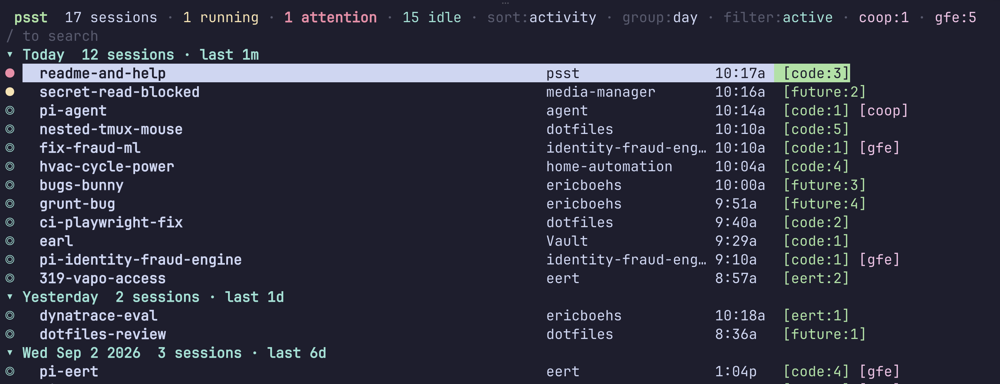

# psst

**p**i **s**ession **s**witcher for **t**mux — browse, inspect, and resume
[pi coding-agent](https://github.com/earendil-works/pi-mono) sessions from one
TUI. Built because nothing combined both halves: mining the full session
archive *and* showing which agents are running right now.



- `●` yellow = live, working (`thinking` / `tool:*` from agent-link, except the prompt tools below — or subtree CPU ≥5% when no hook status is present)
- `●` red + bold title = blocking prompt (`tool:ask` / `tool:confirm` / `tool:input`)
- `●` cyan + bold title = unread (tmux `@special_activity`, not focused yet)
- `◎` cyan = live, waiting, already looked at
- `○` gray = not running
- `[code:3]` green = the tmux session/window the running agent lives in
- `[coop]` magenta = remote host badge
- `⎇` = session was forked from a parent (`/fork`, `/clone`)

## Install

```bash
cd ~/Code/github.com/ericboehs/psst
cargo build --release
# Install via rename (NOT cp over the old file): overwriting the binary in
# place leaves macOS's taskgated signature cache stale and the new binary
# dies with "zsh: killed" (SIGKILL, Taskgated Invalid Signature). Re-sign
# after install for the same reason.
cp target/release/psst /tmp/psst.new && mv -f /tmp/psst.new ~/.local/bin/psst
codesign --force --sign - ~/.local/bin/psst
```

Rust via Homebrew is the only dependency. tmux is required for opening sessions.

## Usage

```bash
psst                  # TUI (local + configured hosts)
psst .                # TUI, only this project (git root, else cwd; any dir works the same)
psst --list           # plain table with a host column (pipe-friendly)
psst --json           # JSON array (same rows as --list; each row has "host")
psst --local --json   # local sessions only; never syncs or probes configured hosts
psst --local --open ID # exact local session ID (or absolute JSONL path); open + focus without a TUI
psst --refresh        # rebuild the metadata cache from scratch (re-mirrors hosts)
psst --debug-running  # print detected pi processes + tmux targets (local + hosts)
psst --debug-focus    # print terminal tabs and which host each one holds
psst --help           # usage
psst --version        # version and the git commit it was built from
```

Remote sessions carry a magenta `[coop]` badge, show up in the header as
`coop:11`, match `coop` in `/` search, and open over ssh (see below).
When a host is unreachable its error appears in the header and `psst` keeps
working with the last mirror + local sessions.

### Local web/launcher handoff

`--local` removes configured hosts before any discovery, cached-host loading,
refresh, or detection. It also works with the TUI and `--list`. The normal
metadata cache can still be updated; browsing does not modify session JSONL.

`psst --local --open ID` accepts an **exact** discovered local session ID or
absolute file path. Ambiguous IDs and unknown files fail rather than opening
something similar. This command cannot be combined with list/debug/refresh/scope
options and currently requires `--local`.

The command reuses the TUI's opening planner and delegates terminal focus to
`tmux-focus` from [agent-notify](https://github.com/ericboehs/agent-notify).
An attached local tmux client is required. A running session's existing target
is focused; a stopped session gets a new resume window in the most recently
active client's tmux session. A running agent without a known tmux target is
rejected rather than duplicated. No prompts are sent.

Ghostty is the default (`[ui] terminal` overrides it). Its tab hop needs macOS
Accessibility permission and remains best-effort: success means a handoff was
requested, not that the operating system verified focus. Custom `[resume]`
commands retain their existing, trusted shell-template semantics.

### Keys

| Key | Action |
|-----|--------|
| `/` | focus search (then type anything, including `j`/`k`; Esc unfocuses). Running sessions also match `active`/`running` (plus `working`, `waiting`, `prompt`, …). |
| `f` | cycle list filter: all → named → active |
| `g` or `Tab` | cycle grouping: flat → project → day → host |
| `s` or `Ctrl+S` | cycle sort: activity → tmux. Working sessions hold their row until they go idle (or you press `r`), so the list does not jump while agents run |
| `↑`/`↓` or `k`/`j`, PgUp/PgDn, Home/End | navigate rows — group headers are stops too (arrows/PgUp/PgDn/Home/End work while searching; `j`/`k` type into search when focused) |
| `J` / `K` | next / previous group (project/day/host; no-op when flat) |
| `h` / `l` | fold / unfold the current group |
| `H` / `L` | fold / unfold all groups |
| `?` | shortcut overlay, also in the TUI footer (`?`/`Esc`/`q` closes it) |
| `Enter` | **open**: attach to the running tmux session, or spawn `pi --session <file>` in a new tmux window (on a header: toggle fold). Remote sessions focus the terminal tab already holding that host's ssh (see below) |
| `d` or `Ctrl+D` | toggle the bottom detail pane (off by default) |
| `p` or `Ctrl+P` | hide/show last user prompt on a second line under each row |
| `r` / `R` | rescan (cache-aware) / full rescan |
| `Backspace` | delete the last search-filter character (even when search is not focused) |
| `Esc` | unfocus search, then clear filter, then quit (closes the `?` overlay first) |
| `q` or `Ctrl+C` | quit |

| Mouse | Action |
| --- | --- |
| wheel | scroll the selection (3 rows per notch) |
| click | open the row, same as `Enter`; on a group header, fold or unfold it |
| right-click a row | show details for it; the same row again hides them, another row keeps the pane up |
| click `sort:` / `group:` / `filter:` in the header | cycle that setting |
| click the search row (or `/ search`) | focus search |
| click `d details` / `p prompts` in the footer | toggle that pane; the label lights up while it is on |
| click `? keys` / `enter=open` / `q quit` | as labelled |

Capturing the mouse takes over the terminal's own drag-to-select, so hold
Shift to select and copy text as usual (Ghostty, iTerm2, xterm). Right-click
goes to psst too, so the terminal's context menu will not appear while psst
is focused. Set `[ui] mouse = false` to leave the mouse entirely to the
terminal.

Local running detection ticks every 1s (~40ms: process cwds are cached for
30s, since re-reading them every second dominated the tick); the session
archive rescans every 10s. The first frame is drawn entirely from the cache
— local sessions plus
the host mirrors — so it lands in ~0.15s and already lists every host; only
remote *running* state waits for the background worker. Remote hosts sync +
detect on the 10s rescan (and `r`/`R`) only, and the rescan runs on that
worker thread — keys stay live while ssh is in flight (a dim `sync…` badge
in the header shows work is pending, and the selection is preserved across
the swap). `psst --refresh` forces a full rebuild on that worker too, so it
no longer delays the first frame. View filter, grouping, sort, detail, prompts, the selected row, and folded
groups are restored the next time you open psst
(`~/.cache/psst/ui-state.json`); search text is not.

Group headers (project, day, and host modes) show session count and the
newest activity in the group. Day buckets use local dates; within a
group, rows keep the active sort's order. In host mode local sorts first,
then remotes by recency. In day mode rows show clock time (`2:04p`);
otherwise they show age (`312m`). Rows are laid out for the current
terminal width: on narrow terminals the project column shrinks away first,
so age and tmux/host badges stay visible; the header and footer wrap onto
more lines instead of running off the edge, and group headers truncate with
an ellipsis.

## How it works

- **Sessions**: JSONL trees under `~/.pi/agent/sessions/<encoded-cwd>/*.jsonl`
  (format v3, see pi's `session-format.md`). psst reads the header for the
  project cwd, then scans for `session_info` names, first user prompt, models,
  token/cost usage (`usage.cost.total`, including nested toolResult usage),
  and branch points (entries with >1 children). Respects `PI_CODING_AGENT_DIR`.
- **Running detection** (zero-config, per design): pi appends via
  `open/write/close`, so `lsof` only catches files mid-write. Instead psst
  matches pi-like processes (via `ps`), resolves cwds batched via `lsof`
  (macOS, cached 30s) or `/proc` (Linux), resolves their tmux pane from the
  inherited `TMUX_PANE` env var (falling back to a parent-chain walk to
  `pane_pid`), and pins a session file: exactly when the cmdline carries
  `--session` (id or path); else the session whose `created` timestamp is
  closest to the process start within `active_secs` (default 120s, for a
  bare `pi` that writes its header at launch); else the newest unclaimed
  session in that cwd — no recency gate, a live pid is enough, so idle
  agents at a prompt still pin. Parallel agents in one project
  claim distinct files (newest-first), so each maps to its own tmux window.
- **Open**: running sessions switch/attach to their tmux target (window, not
  just session); idle sessions spawn a new tmux window (or detached session
  when outside tmux) running the resume command in the session's project cwd.
- **Opening a remote session**: a session on another box already has a home on
  screen — the terminal tab holding an ssh to that host — so psst brings that
  tab forward instead of stacking a second ssh beside it. Running sessions
  select their window in the remote tmux first; idle ones get a new window in
  the *host's own* tmux (in the session that tab is attached to, so it lands
  where you are looking, and it outlives the tab). The click is delegated to
  [`tmux-focus`](https://github.com/ericboehs/agent-notify), which drives the
  tab bar through the accessibility API — macOS exposes no way to focus a
  Ghostty surface. Tabs are matched by title, most specific first: `coop:`
  (a remote tmux renames the tab to `<host>:<session>:<window> …`), then
  `ssh coop` (Ghostty titles a bare tab with its command), then plain `coop`
  last, since that also matches a tab merely mentioning the box. Pin one with
  `tab = "…"` under the host. When the tab, `tmux-focus`, or the Accessibility
  grant is missing, psst falls back to the old behaviour: `ssh -t <host>`
  running `tmux select-window … \; attach` (or `cd <cwd> && <command>`) in a
  new *local* tmux window. `psst --debug-focus` prints the visible tabs and
  what each host resolves to, since these failures are otherwise invisible.
- **Hosts**: each `[hosts.<name>]` entry is dialed over multiplexed ssh
  (`ControlMaster=auto`, sockets in `~/.cache/psst/ssh/`, 10min persist —
  the first connection pays the handshake, follow-ups cost milliseconds,
  across psst runs too). Calls are batched to ~4 per host per rescan
  (list, `ps`, tmux+probe+cpu sections, enrichment) and mirrored to
  `~/.cache/psst/hosts/<name>/<absolute-remote-path>` (only changed files
  are fetched, checked against the shared metadata cache). The mirror backs
  the detail pane, so remotes stay browsable while offline. Running
  detection runs `ps` + `tmux list-panes` + one batch `/proc` probe per host
  (cwd from `/proc/<pid>/cwd`, `TMUX_PANE` from `/proc/<pid>/environ`),
  plus peer names from `~/.claude/sessions/<pid>.json` and status from
  `~/.cache/agent-link/summaries/<pid>.json` when present. Matching is
  partitioned by host, so identical cwds on two machines never cross-match.
  Minted fallback names are host-prefixed (`pi-coop-agent`).
- **Working without the hook**: hosts lacking agent-link summaries (gfew runs
  `pi-claude-link` instead; coop has neither) report no `thinking`/`tool`
  status, so psst falls back to subtree %CPU (process plus descendants, so
  `tool:bash` children count): ≥5% reads working. This is a heuristic, not proof
  of an active agent turn: CPU readings can linger after work ends, and a
  background dev server can remain busy indefinitely. Explicit `idle` status
  therefore wins over CPU (while tmux unread activity is still preserved).
  The detail pane shows the reading
  (`working pid 80608 @ code:1 (heuristic) · cpu 9%`).
- **Cache**: parsed metadata is cached at `~/.cache/psst/cache.json`, keyed by
  host+path+mtime+size, so rescans only reparse changed files. Files ≥5MB
  additionally persist fold state (lines folded + parent→child counts), so a
  rescan folds only appended tail lines instead of re-reading megabytes —
  exact, including branch points, since session files are append-only.

## Config — `~/.config/psst/config.toml`

```toml
[resume]
# {file} = session jsonl path, {id} = session uuid, {cwd} = project dir
command = 'pi --session {file}'

[detection]
active_secs = 120

[ui]
# grouping on launch: "day" (default), "project", "flat", or "host"
group = "day"
# show the bottom detail pane on launch (default: false; `d` toggles)
detail = false
# terminal whose tabs are focused when opening a remote session
terminal = "Ghostty"
# mouse: click to select, double-click to open, wheel to scroll.
# false leaves the mouse to the terminal (Shift+drag selects text either way)
mouse = true

[hosts.coop]
# ssh target as in `ssh <target>` (key-based, BatchMode — no passwords)
ssh = "coop"
# enabled = true (default when the table exists; false hides the host)
# sessions_dir = ".pi/agent/sessions" (default; $PI_CODING_AGENT_DIR wins
#   on the remote when set; absolute or ~/ paths also allowed)
# tab = "coop:"  (tab-title fragment holding this host's ssh; guessed from
#   the name and ssh target when unset — see `psst --debug-focus`)

[hosts.gfe]
# display name and ssh target may differ: this entry shows as `gfe` but
# dials the wired alias (only one of gfe/gfew is reachable at a time).
ssh = "gfew"
```

Linux and macOS remotes both work: session listing uses GNU `find -printf`
with a BSD `stat` fallback, and the process probe reads `/proc` on Linux
vs `lsof` + `ps eww` on macOS (same sources as local detection).

If you launch pi through mise or a wrapper, point `command` at it, e.g.
`command = 'mise x -- pi --session {file}'`.

## Non-goals (v1)

No editing/deleting sessions, no forking, no analytics dashboards. Host
mirrors are read-only (list/inspect/open over ssh) — session mutation stays
in pi.

## Status

Prototype. Parser is unit-tested against the documented v3 format; local
running detection is heuristic and tuned for macOS + tmux 3.x (pi launched
from a shell pane). Remotes support Linux and macOS (see above).